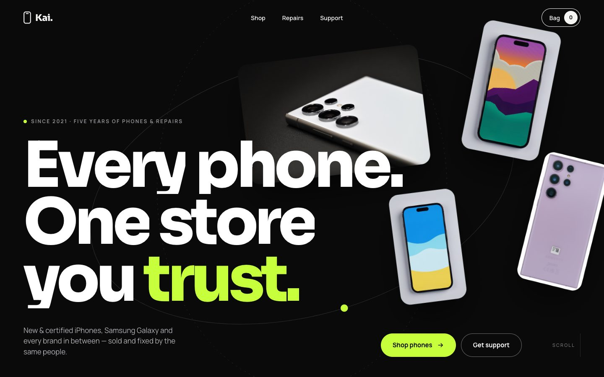
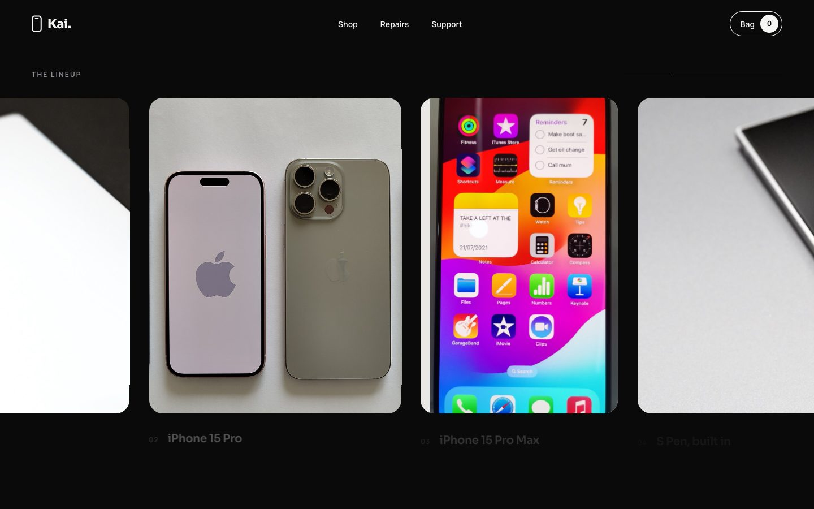
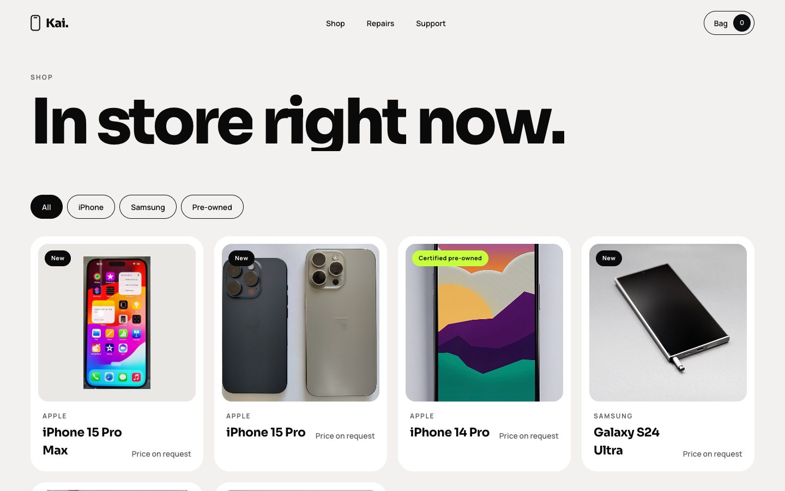
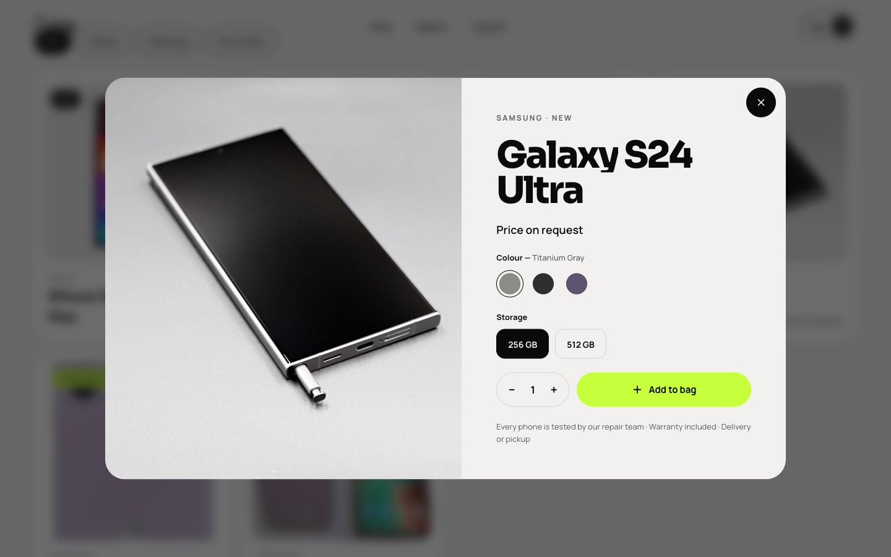
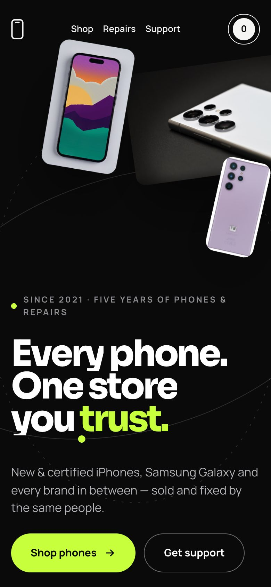

# Kai Store

A cinematic one-page website for Kai Store, a phone shop that sells iPhones, Samsungs and other phones and does repairs. Visitors can browse and buy phones, book a repair or contact support. The interface is kept minimal so the motion carries the experience. All of it is built with [anime.js](https://animejs.com) v4.

**[Live demo →](https://yanziiauad.github.io/kai-store/)**



| Pinned horizontal lineup | Shop with filters | Product and buy flow |
| --- | --- | --- |
|  |  |  |

<p align="center"></p>

## Highlights

- **Opening sequence:** a single timeline draws a phone outline, runs a counter, lifts the curtain and hands straight into the hero.
- **Hero:** real photos float at different depths and react to the mouse. An SVG orbit draws in with a dot moving along its path, and the headline rises letter by letter.
- **Scroll:** the hero dissolves, a brand marquee speeds up with scroll velocity, a paragraph lights up word by word, and a pinned section moves a photo track sideways.
- **Cursor and hover:** a trailing cursor ring with context labels, magnetic buttons, 3D card tilt, letter-roll nav links, SVG icons that redraw, and a springy footer wordmark.
- **Shop:** animated filters, a product dialog that opens with a clip-path reveal, an image that arcs into the bag, a bag drawer and checkout.
- **Accessibility:** real buttons and labels, focus-trapped dialogs, Escape to close, and full `prefers-reduced-motion` support.

**Stack:** Vite, vanilla JavaScript, anime.js v4 (timelines, `onScroll`, `splitText`, `createDrawable`, `createMotionPath`, `createAnimatable`).

## Run it

```bash
npm install
npm run dev       # local dev server
npm run build     # production build → dist/
npm run preview   # serve the build
```

`dist/` is a static site, so you can host it anywhere (Netlify, Vercel, Cloudflare Pages, GitHub Pages).

## Make it yours

Everything store-specific is in **`src/data.js`**:

- **`store`** has the phone, email, address, city, opening hours and the currency prefix.
  - **`whatsapp`**: set this to a number in international format, digits only. Orders and support messages then open WhatsApp already filled in with the customer's details. Leave it empty and the forms only show a confirmation, so nothing is sent.
- **`products`** has the name, brand, condition, photo, colours, storage and `price` for each phone.
  - Set `price` to a number, or leave it as `null` to show "Price on request".
- **`repairs`** lists the repair services.
- **`credits`** holds the photo credits, which the Creative Commons licences require. If you swap in your own photos, remove their credits.

To use your own photos, put them in `public/img/` and point each product's `img` at them.

## Where the motion lives

| File | What it does |
| --- | --- |
| `src/intro.js` | Loader timeline (the phone outline draws itself, a counter runs, the curtain lifts), the hero fly-in, idle floating, orbit motion path, mouse parallax |
| `src/scroll.js` | Hero exit, marquee that speeds up with scroll, word-by-word statement, pinned horizontal lineup, repair rows, footer wordmark |
| `src/shop.js` | 3D card tilt, filter transitions, product dialog timeline, fly-to-bag, bag drawer, checkout |
| `src/cursor.js` | Trailing cursor ring with hover labels |
| `src/motion.js` | Shared helpers: split-text reveals, magnetic buttons, link roll |

If a visitor has "reduce motion" turned on, the site skips the loader and the motion and shows everything at once.

## Photos

Product photos come from Wikimedia Commons under CC BY / CC BY-SA licences. They're credited in the footer under "Photo credits", and in `src/data.js`.
